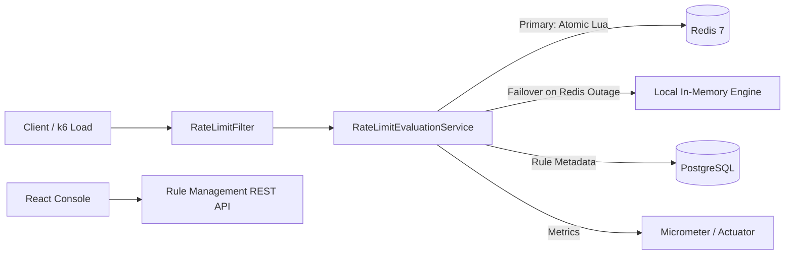

# Distributed Rate Limiter & API Gateway

[](https://github.com/srimannarayanavarmaracha/distributed-rate-limiter-gateway/actions/workflows/ci.yml)


A production-oriented, atomic **Distributed Rate Limiter** built with **Java 21, Spring Boot 4.2, Redis (Lua scripting), PostgreSQL, and React + TypeScript**. Designed to demonstrate low-latency traffic shaping, concurrency safety, and graceful degradation under failure.

## Architecture



## Key Engineering Highlights

- **Atomic Redis Lua Execution (`token_bucket.lua`, `sliding_window.lua`):** Eliminates read-modify-write race conditions across multiple gateway replicas in a single Redis round-trip.
- **Graceful Degradation (Resilience):** If Redis becomes unreachable, `RateLimitEvaluationService` automatically fails over to `LocalTokenBucketRateLimiterEngine` and surfaces `X-RateLimit-Backend: local-memory` instead of cascading failures.
- **Standard Rate-Limit Headers & RFC 7807 Errors:** Injects `X-RateLimit-Limit`, `X-RateLimit-Remaining`, `X-RateLimit-Reset`, and `Retry-After`, returning `application/problem+json` on HTTP `429`.
- **Java 21 Virtual Threads:** Enabled via `spring.threads.virtual.enabled=true` for high-concurrency I/O throughput.

## Trade-offs: Token Bucket vs. Sliding Window Log

| Dimension | Token Bucket (`token_bucket.lua`) | Sliding Window Log (`sliding_window.lua`) |
| :--- | :--- | :--- |
| Memory per key | `O(1)` (2 hash fields) | `O(N)` sorted set entries per window |
| Burst handling | Controlled burst up to `capacity` | Strict cap within rolling window |
| Best suited for | General APIs & burst-tolerant clients | Auth/payment endpoints needing strict caps |

## Quick Start (Docker Compose)

```bash
cp .env.example .env
docker compose up --build
```
- **React Console:** `http://localhost:3000`
- **Backend API:** `http://localhost:8080/api/v1/rules`
- **Actuator Metrics:** `http://localhost:8080/actuator/metrics`

## API Quick Check

```bash
# List active rate limit rules
curl -s http://localhost:8080/api/v1/rules

# Send burst traffic and inspect X-RateLimit-* headers
for i in {1..7}; do
  curl -i -s -H "X-Client-Id: demo-user" http://localhost:8080/api/v1/demo/resource | head -n 8
done
```

## Running Tests & Load Benchmarks

```bash
# Backend unit, 50-thread concurrency & MockMvc integration tests
cd backend && ./mvnw test

# k6 burst benchmark (120 req/s)
k6 run load-tests/rate-limit-load.js
```

## License

Licensed under the [MIT License](LICENSE).
